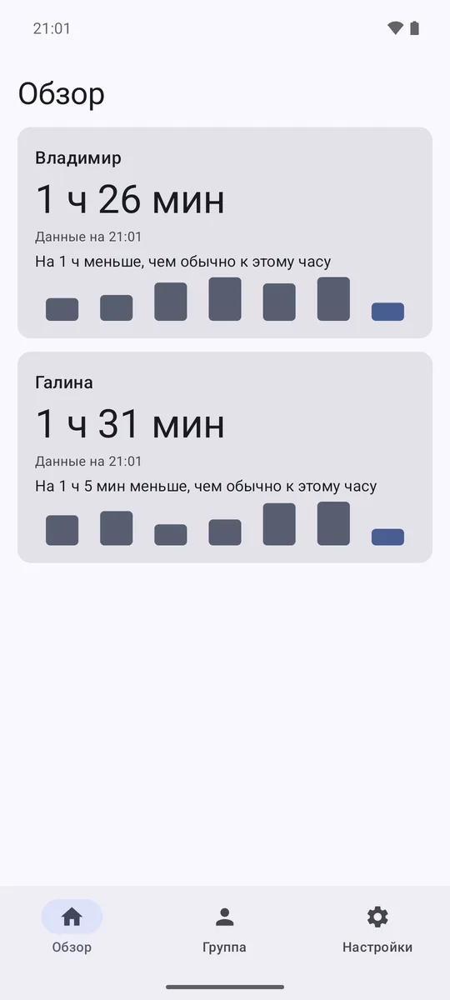
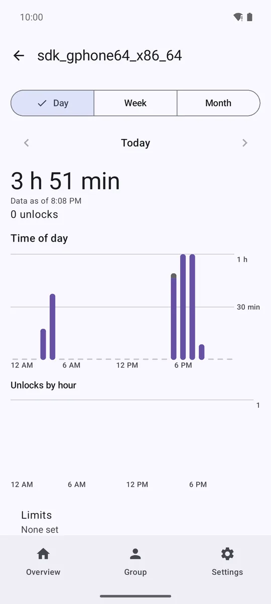
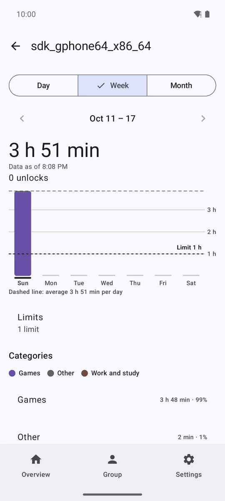
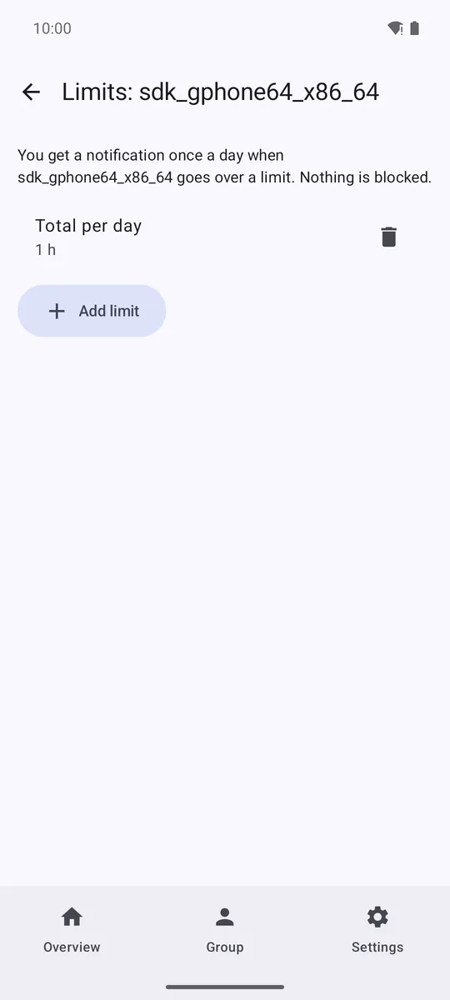
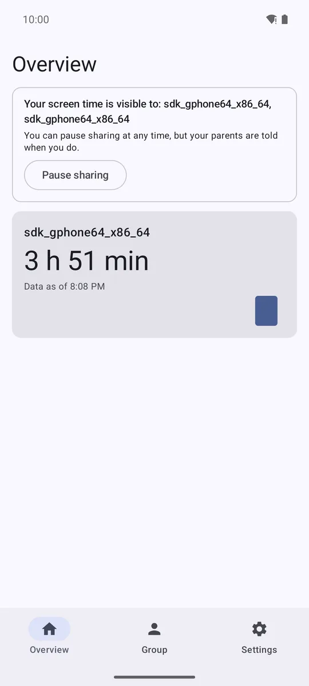
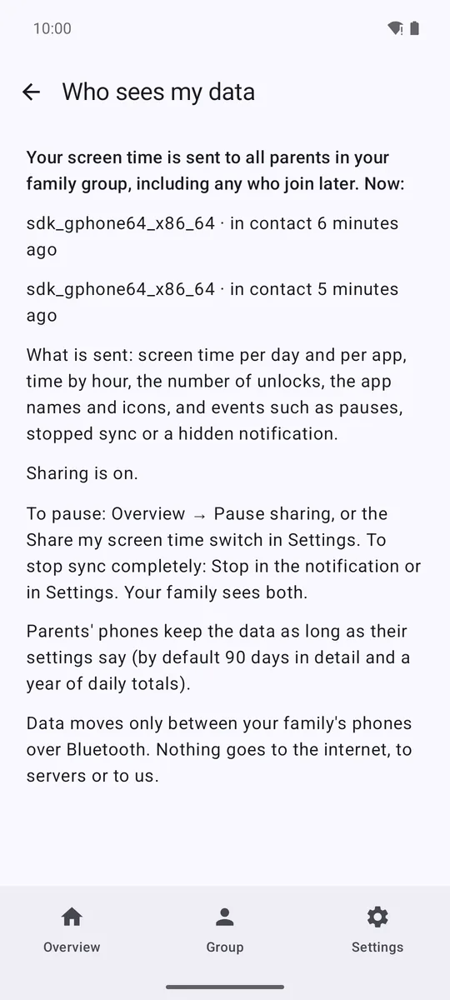

# Kinsight

Family screen time, phone to phone. A child's phone shares its screen time with the parents' phones over Bluetooth, with the child's consent on the child's phone. No servers, no accounts, the app never connects to the internet.

## Download (Android 12+)

The app is distributed as an APK while it is in family testing.

- **Latest release:** see [Releases](https://github.com/avkudryashov/kinsight/releases/latest) (file `kinsight-<version>.apk`, SHA-256 in the release notes).
- Install: open the downloaded file, allow installation from this source when Android asks. Updates install over the previous version and keep your data.
- Xiaomi (MIUI): after installing, open Settings → Apps → Kinsight and enable **Autostart**, set battery saver to **No restrictions**, and lock the app in Recents; otherwise MIUI stops the background sync.

## Screens

## Privacy

- [Privacy Policy (English)](privacy-en.html)
- [Политика конфиденциальности (русский)](privacy-ru.html)
- [Política de privacidad (español)](privacy-es.html)

## Source

The code is public: [github.com/avkudryashov/kinsight](https://github.com/avkudryashov/kinsight).
