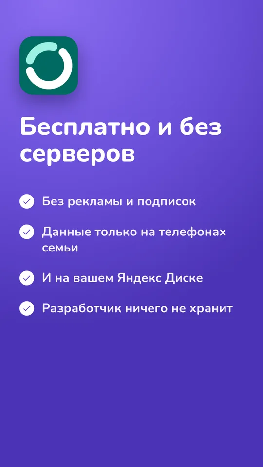
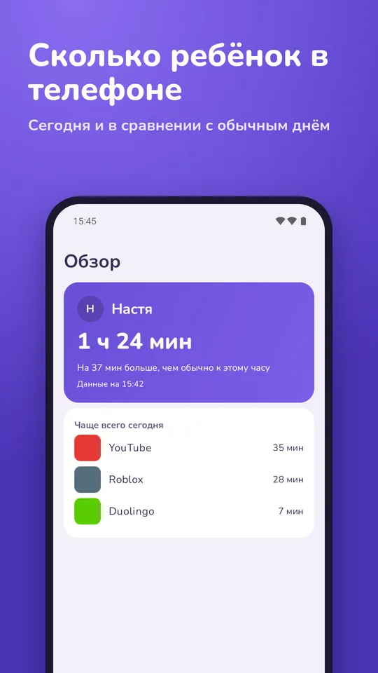
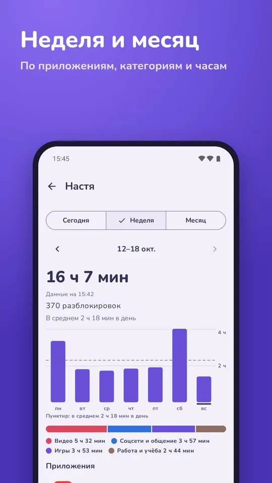
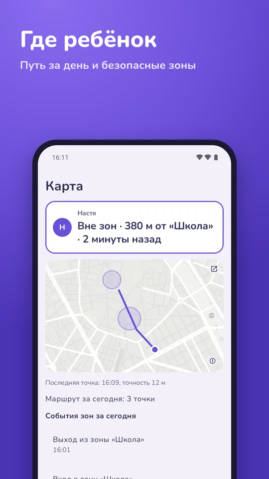
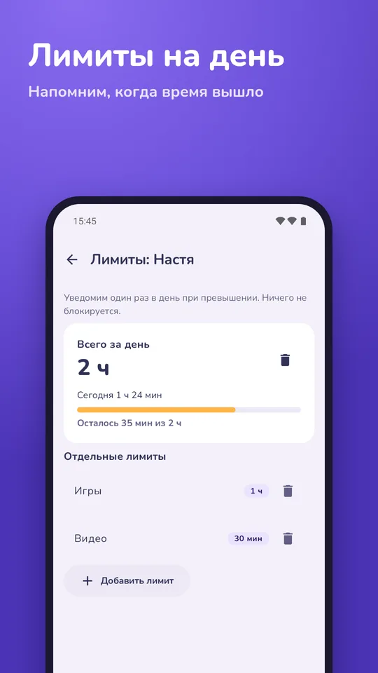
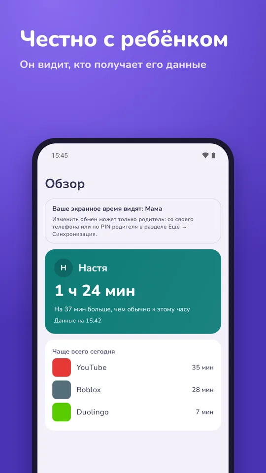

# Kinsight

Экранное время и где ребёнок. **Бесплатно, без серверов: только ваш Яндекс Диск.**

[Скачать для Android](https://github.com/avkudryashov/kinsight/releases/latest) · [RuStore](https://www.rustore.ru/catalog/app/app.kinsight)

## Что умеет

- **Экранное время:** сегодня, неделя и месяц, по приложениям и по часам; лимиты на день, блокировка приложений и категорий, белый список «всегда разрешено»; правила задаёт родитель, а закрывает приложение телефон ребёнка.
- **Где ребёнок:** последнее место и путь за сегодня на карте улиц; безопасные зоны, например дом и школа, с уведомлением, когда ребёнок пришёл или ушёл.
- **Честно с ребёнком:** ребёнок соглашается на своём телефоне и всегда видит, кто получает данные; изменить обмен может только родитель, с PIN.

## Без серверов

Рядом телефоны обмениваются данными по Bluetooth, даже без интернета. Издалека синхронизируются в зашифрованном виде через Яндекс Диск родителя. Нет аккаунтов и аналитики, разработчик ничего не хранит. Карта улиц загружается с OpenFreeMap. Подробно: [Политика конфиденциальности](privacy-ru.html).

## Установка

Android 12 или новее. Установите из [RuStore](https://www.rustore.ru/catalog/app/app.kinsight) или возьмите APK `arm64-v8a` в [Releases](https://github.com/avkudryashov/kinsight/releases/latest) (`armeabi-v7a` для старых телефонов); обновление ставится поверх и сохраняет данные. На Xiaomi включите для Kinsight **Автозапуск** и режим батареи **Нет ограничений**.

## Бесплатно и с открытым кодом

Kinsight бесплатный и распространяется двумя путями: через [RuStore](https://www.rustore.ru/catalog/app/app.kinsight) и через [GitHub](https://github.com/avkudryashov/kinsight/releases/latest). Код открыт под лицензией Apache 2.0: [github.com/avkudryashov/kinsight](https://github.com/avkudryashov/kinsight).

Проект открыт для контрибьюторов. Сообщайте об ошибках и предлагайте идеи в [Issues](https://github.com/avkudryashov/kinsight/issues), присылайте исправления и новые функции через pull request. Как собрать проект, описано в [README](https://github.com/avkudryashov/kinsight#build).
